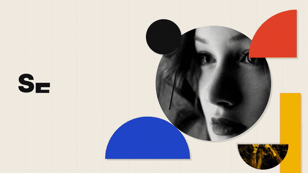

# 几何拼贴 · 动态海报

将四张照片裁成几何形状，在三组包豪斯动态海报中重组，适合活动与视觉主题展示。

**16:9 · 1920 × 1080 · 60 fps · v2.5.3** · [@prism-studio](https://motiongit.com/@prism-studio) · [English](README.md)

**[模板详情、完整 .motion 与 Demo](https://motiongit.com/@prism-studio/visual-art-c-collage)**
https://motiongit.com/@prism-studio/visual-art-c-collage

下载已开放，当前许可见模板页面与下载包。

## Demo

[查看完整样片](https://motiongit.com/@prism-studio/visual-art-c-collage) · [播放视频](https://media.openaicut.com/previews/617/draft-en-b232ff8db7c6.mp4)

## 技术原理

- 声明的运行配置：html-canvas/1。
- 通过模板参数和预设，将本期文字、数据或素材映射到已有动画工程。
- 已声明时间轴为固定时长，本期内容按现有场景顺序和节奏适配。

样片时长: **13s**. 已声明输出为 1920 × 1080，60 fps；公开样片 13 秒。 按实际包的参数边界制作；增加素材不会自动增加场景。

## 输入素材与内容

- **必需:** 这次要呈现的照片与作品标题。已声明照片输入为 4 张。
- **可选:** 本期已授权配乐，或本期是否需要配乐的偏好。
- **可选:** 本期配音文件，或是否需要配音的安排。

适用内容: Make the user's photos into the existing visual composition; retain every original effect and time cue.

## 运行环境

- 模板声明使用 Python 和 Node.js。具体工具与版本以下载包为准。
- 按下载包的依赖锁和 setup/check 说明检查已有工具，只补齐缺项，并验证预览。

## 使用模板

1. 从[模板页面](https://motiongit.com/@prism-studio/visual-art-c-collage)获取当前版本的完整 .motion。
2. 按包内说明解压或加载，读取 README 和引用的制作指南。
3. 使用本期内容与素材，复用已有环境，按包内入口制作并查看实际预览。

可将下面这段请求与仓库地址交给助手：

> https://github.com/motiontemplates/907345
>
> 请使用这个 .motion 模板制作。模板地址：https://motiongit.com/@prism-studio/visual-art-c-collage。取得模板后按其说明解压或加载，读取包内 README 和引用的指南，复用已有环境，用我的内容制作并展示实际预览。

## .motion 格式

MotionGit .motion 是可复用的视频模板格式，组织动画工程、参数、素材、依赖与制作指南。运行时按本期内容再次制作，输出 MP4 等成片。 [格式说明](https://motiongit.com/spec)

[版本、许可与完整下载](https://motiongit.com/@prism-studio/visual-art-c-collage) · [制作参考](ASSISTANT.zh-CN.md)
